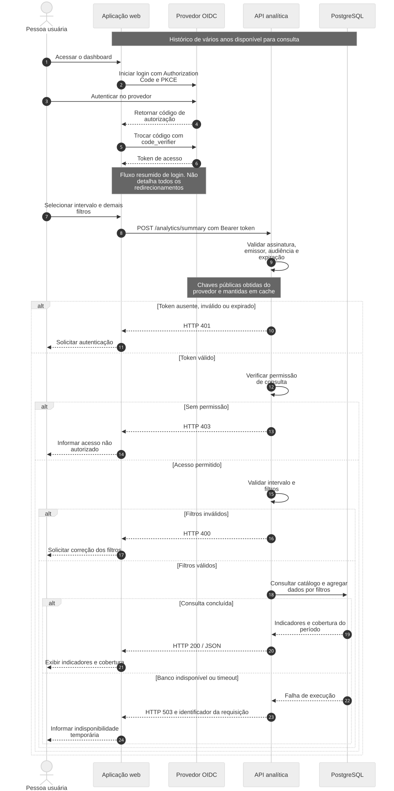

# DataSUS Quimioterapia · Arquitetura

Proposta de arquitetura para uma aplicação de consulta a indicadores de quimioterapia do SUS, com **acesso autenticado e histórico de vários anos em PostgreSQL**. O documento define o recorte do sistema, suas responsabilidades, decisões de arquitetura e lacunas para orientar o desenvolvimento.

## 1. Contexto e escopo

A aplicação permite explorar indicadores agregados de APAC de quimioterapia por intervalo de competências, UF, CID e procedimento. A pessoa usuária autentica-se, seleciona filtros e visualiza totais, tabela paginada e evolução mensal. Também pode exportar resultados agregados em CSV.

A premissa é que o PostgreSQL já contém o histórico de vários anos. Um processo externo mantém essa base atualizada e registra a cobertura disponível por competência e UF. A consulta usa essa base, sem depender de acesso à fonte dos dados durante a navegação. O mecanismo de alimentação não faz parte deste recorte.

Os indicadores previstos são quantidade de registros, APACs distintas e valor aprovado. **APACs não equivalem a pacientes únicos**; a definição exata de cada indicador deverá constar do dicionário de dados.

### Escopo e nível da visão

- **Incluído:** autenticação, autorização de consulta, seleção de filtros, indicadores históricos, tabela paginada, série mensal e exportação CSV.
- **Fora do escopo:** mecanismo de alimentação do banco, gestão de credenciais de usuários, atendimento clínico, prontuário, recomendações terapêuticas e escolha da infraestrutura de implantação.
- **Visão estrutural:** containers inspirados no C4, representando aplicações, banco e dependências externas. O termo container não implica uso de Docker.
- **Visão comportamental:** autenticação e consulta de um resumo de indicadores, com as principais respostas de sucesso e falha. Tabela, série mensal e exportação seguem o mesmo controle de acesso, mas não são repetidas na sequência.

## 2. Componentes, limites e responsabilidades

| Componente | Responsabilidade | Limite |
|---|---|---|
| Aplicação web · Next.js, React e TypeScript | Login, filtros, apresentação e exportação dos resultados | Não acessa o banco diretamente nem decide a autorização |
| Provedor de identidade · OpenID Connect | Autenticar pessoas e emitir tokens | Produto, configuração e administração do provedor ainda serão definidos |
| API analítica · Fastify e TypeScript | Validar tokens, permissões e filtros; consultar e agregar dados | Não recebe senhas e não atualiza o histórico |
| PostgreSQL | Armazenar o histórico e o catálogo de cobertura; executar consultas | Acesso restrito aos componentes autorizados |
| Processo externo de atualização | Alimentar dados e publicar a cobertura disponível | Seu mecanismo interno está fora do escopo; o contrato de atualização precisa ser definido |

A API usa uma credencial de banco com permissão de leitura. O processo de atualização utiliza credencial separada. A autorização de pessoas é validada pela API, mesmo que a interface também oculte recursos sem permissão.

## 3. Diagrama estrutural



[Consultar fonte Mermaid](diagramas/estrutura.mmd) · [Rascunho simplificado](diagramas/inicial/estrutura.mmd)

As setas indicam chamadas ou uso de recursos. A identidade e a atualização são dependências externas à fronteira da aplicação. A obtenção de chaves públicas pelo backend não representa uma chamada ao provedor a cada consulta: a proposta usa validação local do token e cache de chaves, cuja política de atualização permanece pendente.

## 4. Diagrama comportamental



[Consultar fonte Mermaid](diagramas/consulta.mmd) · [Rascunho simplificado](diagramas/inicial/consulta.mmd)

O fluxo usa OpenID Connect com Authorization Code e PKCE para o acesso da aplicação web. A sequência simplifica os redirecionamentos e apresenta o caminho de login bem-sucedido; cancelamento, falhas do provedor e encerramento da sessão deverão ser detalhados antes da implementação.

Na consulta, a API valida o token de acesso, verifica a permissão e valida os filtros antes de acessar o PostgreSQL. A resposta inclui a cobertura disponível no intervalo, evitando confundir ausência de dados com ausência de ocorrências. Tokens inválidos recebem 401; falta de permissão, 403; filtros inválidos, 400; indisponibilidade ou timeout do banco, 503.

## 5. Decisões de arquitetura

| Decisão | Justificativa | Consequência ou ponto de atenção |
|---|---|---|
| PostgreSQL como base histórica | Reúne armazenamento relacional, filtros e agregações SQL em um componente conhecido | Índices, eventual particionamento e pré-agregações dependerão do volume e das medições |
| TypeScript na interface e na API | Mantém uma linguagem comum e facilita contratos compartilhados | Tipos não substituem validação de entrada em execução |
| Autenticação delegada a um provedor OIDC | Centraliza a identidade e evita manter senhas na aplicação | Exige definir provedor, clientes, audiências, permissões e ciclo de vida dos tokens |
| Autorização na API | Impede que a proteção dependa apenas da interface | As rotas devem negar acesso quando não houver a permissão exigida |
| Alimentação fora do escopo de consulta | Mantém o recorte focado na experiência de análise | O contrato de atualização, consistência e disponibilidade da base precisa ser acordado |
| Resultados agregados e paginação | Limita a exposição e o tamanho das respostas | Regras para grupos pequenos e limites de exportação ainda precisam ser definidos |

### Restrições e lacunas

O histórico abrange vários anos, mas o intervalo exato e a cobertura por UF dependem do catálogo da base. Não se presume que todo período esteja completo. Consultas extensas podem exigir otimização; desempenho e escalabilidade devem ser medidos, não inferidos apenas pela escolha do banco.

A aplicação depende da disponibilidade do PostgreSQL e do provedor de identidade. O processo de atualização pode modificar a base durante o uso; por isso, deve ser definida uma estratégia de publicação consistente dos dados e identificação de sua versão.

Dados agregados não eliminam automaticamente riscos de identificação. Campos permitidos, critérios para grupos pequenos, logs e exportação precisam de regras explícitas. A observabilidade deve registrar duração, resultado e identificador das requisições sem incluir tokens ou dados desnecessários.

## 6. Geração e revisão dos diagramas

Os diagramas foram produzidos com GenAI a partir da descrição e das premissas desta proposta. Os [rascunhos](diagramas/inicial/) representam uma primeira visão simplificada; os fontes finais acrescentam os detalhes necessários para tornar responsabilidades e falhas explícitas. O [prompt e o processo](docs/prompt.md) registram o contexto utilizado.

### O que foi representado corretamente

- Separação entre interface, API e banco de dados.
- Uso do PostgreSQL como base histórica, sem limitar a consulta aos últimos meses.
- Autenticação como parte do acesso ao dashboard.
- Consulta de agregações mediada pela API.

### Ajustes realizados

| Simplificação inicial | Ajuste na versão final | Motivo |
|---|---|---|
| Autenticação indicada apenas como um componente | Explicitar provedor OIDC, token de acesso e validação na API | Diferenciar autenticar a pessoa de autorizar cada requisição |
| Caminho de consulta somente com sucesso | Incluir 401, 403, 400 e 503 | Tornar os principais cenários de falha visíveis |
| Banco identificado apenas como histórico | Acrescentar catálogo de cobertura | Evitar interpretar períodos sem dados como resultado zero |
| Atualização da base omitida | Representar um processo externo com acesso de escrita separado | Explicitar a responsabilidade sem expandir o recorte para a alimentação |
| Acesso API → banco genérico | Indicar SQL parametrizado e credencial de leitura | Registrar limites que orientarão a implementação |

Esses ajustes são decisões da proposta, não afirmações sobre funcionalidades já implementadas. A geração e a revisão assistida não substituem a avaliação das escolhas pela responsável pelo projeto.

## 7. Base para desenvolvimento

Os [contratos propostos e as lacunas](docs/contratos-e-lacunas.md) detalham filtros, respostas esperadas e pontos que exigem definição. Para orientar um agente de desenvolvimento com menor margem para inventar decisões, ainda são necessários:

1. Modelo físico e dicionário de dados, incluindo semântica dos indicadores e qualidade.
2. Contratos completos de API, erros e exemplos de entrada e saída.
3. Configuração de identidade, permissões, sessão e renovação de tokens.
4. Contrato de atualização e consistência do histórico.
5. Requisitos mensuráveis de desempenho, segurança, disponibilidade e observabilidade.
6. Critérios de aceitação com dados sintéticos e resultados esperados.

O agente deve tratar as decisões registradas como referência e as lacunas como pendências explícitas, solicitando definição quando afetarem a implementação.

## 8. Reprodução dos diagramas

Os arquivos `.mmd` são a fonte de verdade. Os SVGs versionados permitem visualizar os diagramas no README sem extensão adicional.

Com Node.js 22 e npm:

```sh
npm ci
npm run diagrams
```

A instalação requer rede e o navegador utilizado pelo Puppeteer. O Mermaid CLI está fixado em `11.12.0`, com dependências registradas em `package-lock.json`; a configuração visual está em `mermaid.config.json`. Após alterar um fonte, regenere as imagens, confira a legibilidade e versione os arquivos em conjunto.

A validação documental inclui renderização dos diagramas e conferência das referências locais. Não representa teste funcional ou de desempenho da arquitetura proposta.
